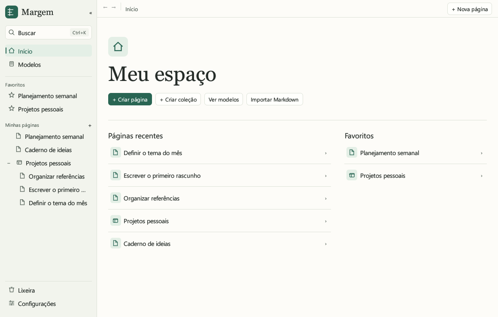
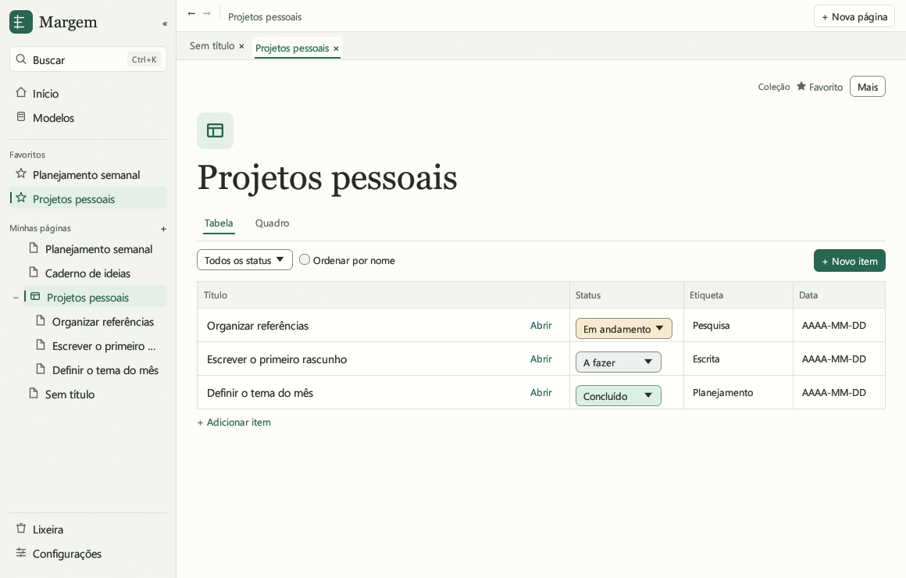
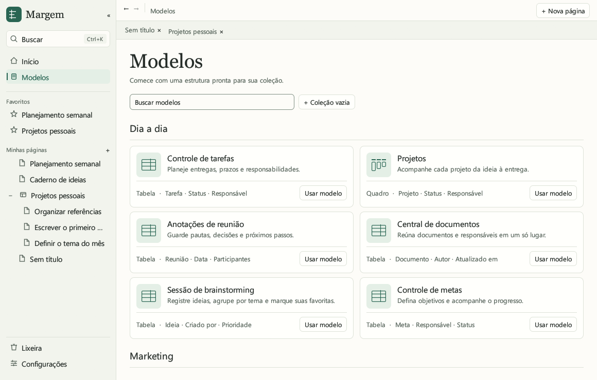

# Margem

**Um espaço de trabalho para suas notas, projetos e ideias.**

Escreva em páginas, reúna tarefas em coleções e organize tudo em uma barra lateral com subpáginas e favoritos. O Margem funciona offline e salva seu espaço de trabalho no próprio dispositivo.

**[Baixar para Windows](https://github.com/RafaelADSdev/notion/releases/tag/v0.1.0)** · [Recursos](#o-que-você-pode-fazer) · [Atalhos](#atalhos) · [Compilar](#compilar-no-windows)



## Instalar no Windows

Na [página da versão 0.1.0](https://github.com/RafaelADSdev/notion/releases/tag/v0.1.0), baixe **Margem-Setup-0.1.0-x64.exe**, execute o instalador e abra **Margem** pelo menu Iniciar. A instalação é por usuário e funciona no Windows 10 e 11 de 64 bits. O aplicativo abre sem conta e sem precisar instalar Rust.

## O que você pode fazer

| Recurso | Como usar |
| --- | --- |
| **Páginas e blocos** | Organize notas em subpáginas e edite títulos, listas, tarefas, citações, código e links. Digite `/` em um bloco vazio para escolher o tipo. |
| **Coleções** | Acompanhe status, etiquetas e datas. Conforme o modelo, alterne entre tabela, quadro, calendário, galeria e agrupamento por categoria. Cada item abre como página. |
| **Busca e navegação** | Encontre páginas pelo título ou pelo conteúdo dos blocos e mantenha várias abertas em abas. Use favoritos para fixar o que consulta com frequência. |
| **20 modelos** | Comece com estruturas prontas para tarefas, projetos, reuniões, calendário de conteúdo, inventário e outros usos. Cada modelo inclui propriedades e seções próprias. |
| **Markdown** | Importe arquivos `.md` e exporte páginas pelo menu **Mais**. |
| **Aparência** | Escolha entre tema claro, escuro ou do sistema. Ajuste a escala, o contraste, a densidade e a largura dos documentos. |

### Coleções



### Modelos



## Atalhos

| Atalho | Ação |
| --- | --- |
| `Ctrl + K` ou `Ctrl + P` | Buscar no espaço de trabalho |
| `Ctrl + N` | Criar uma página |
| `Ctrl + W` | Fechar a aba ativa |
| `Ctrl + E` | Mostrar ou ocultar a barra lateral |
| `Ctrl + ,` | Abrir configurações |
| `/` no início de um bloco vazio | Escolher o tipo do bloco |

## Dados e backup

Na versão instalada, o Margem salva páginas, coleções e preferências em `%LOCALAPPDATA%\Margem\workspace.json`. Para guardar uma cópia completa, feche o app e copie esse arquivo. Para compartilhar uma página individual, use **Mais → Exportar Markdown**. O espaço de trabalho é local a cada usuário do Windows.

## Compilar no Windows

Com Git e Rustup instalados, execute no PowerShell. O script prepara as toolchains de Windows GNU e GNU LLVM fixadas no projeto.

```powershell
git clone https://github.com/RafaelADSdev/notion.git
Set-Location notion

.\.cargo\rustc-windows.cmd
$toolchain = (Resolve-Path '.\target\rustup\toolchains\1.97.1-x86_64-pc-windows-gnullvm\bin').Path
$cargo = Join-Path $toolchain 'cargo.exe'
$env:RUSTC = Join-Path $toolchain 'rustc.exe'
$env:RUSTDOC = Join-Path $toolchain 'rustdoc.exe'
& $cargo test --locked
& $cargo build --release --locked
.\target\release\margem-desktop.exe
```

Para trabalhar com o perfil de desenvolvimento, execute `& $cargo run --locked`. Nesse perfil, o workspace fica na raiz do projeto e o arquivo de dados é ignorado pelo Git.

### Gerar o instalador

Depois de compilar em modo release, execute o compilador do NSIS 3.13 na raiz do projeto. Ajuste o caminho de `makensis.exe` para sua instalação.

```powershell
& 'C:\caminho\para\makensis.exe' .\installer\Margem.nsi
```

O instalador é gerado em `target\installer\Margem-Setup-0.1.0-x64.exe`.

## macOS e Android

Os pacotes de macOS e Android são gerados pelo [GitHub Actions](https://github.com/RafaelADSdev/notion/actions).

- **macOS.** No Mac, com Xcode Command Line Tools e Rustup instalados, rode `bash installer/build-macos.sh`. Abra o DMG em `target/installer/` e arraste **Margem** para **Aplicativos**. Use `arm64` para Apple Silicon e `x86_64` para Intel. O workspace fica em `~/Library/Application Support/Margem/workspace.json`. O app usa assinatura ad hoc e não tem notarização da Apple.
- **Android.** O APK inclui ARM64 e x86-64, requer Android 6.0 ou posterior e usa o armazenamento privado do aplicativo. Para compilar no Linux ou macOS, prepare Android SDK 36, NDK 27.2.12479018, JDK 17, Gradle 9.3.1 e os targets Rust `aarch64-linux-android` e `x86_64-linux-android`. Com `ANDROID_HOME` apontando para o SDK, rode `bash installer/build-android.sh`. O APK de teste é assinado pelo Gradle com a chave de debug.

### Por dentro do projeto

O Margem é um aplicativo nativo em **Rust**, com interface **egui/eframe** e armazenamento local em **JSON**.

| Caminho | Responsabilidade |
| --- | --- |
| [`src/app.rs`](src/app.rs) e [`src/app/`](src/app/) | Navegação, editor, visualizações de coleção, modelos e configurações |
| [`src/model.rs`](src/model.rs) | Páginas, blocos, coleções e conversão Markdown |
| [`src/templates.rs`](src/templates.rs) | Catálogo de modelos e suas propriedades |
| [`src/ui.rs`](src/ui.rs) | Paleta, tipografia e componentes da interface |
